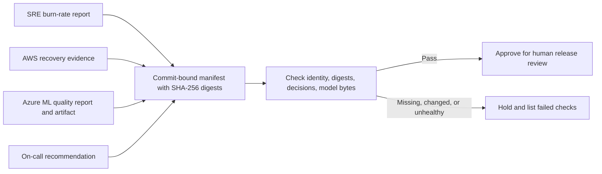

# Release Evidence Pipeline

A CI/CD release gate that combines SRE burn rate, AWS recovery drill, Azure ML artifact quality, and on-call review evidence for a candidate commit.

[Skills and verification](docs/ENGINEERING_NOTES.md)

## Business problem

A passing build alone cannot tell you whether a service is already burning its error budget or a model artifact differs from the one evaluated. Release decisions need evidence tied to the candidate.

## Architecture



## Design and tools

The gate expects healthy SRE, ready AWS recovery, ready model quality and observe from on-call, plus a SHA-256 match for every report and the model artifact. Missing, mismatched, or adverse evidence returns hold with a nonzero exit status. The integration runner produces the actual reports from all four projects in the same checkout group.

**Stack** · Python, unittest, SHA-256 evidence, Make, GitHub Actions workflow template

## Run the demo

Use Python 3.9 or later and Make from the repository root.

```sh
make verify
make verify-integration  # with the four sibling repos cloned beside this one
```

## Deployment

Use [the workflow template](docs/github-actions/ci.yml) for a credential-free runner. An operator can retain a bundle with `python3 demo.py .. --evidence-dir build/healthy` and recheck it with `python3 gate.py build/healthy --commit 0000000000000000000000000000000000000001`. For a live pipeline, supply the real candidate SHA and create reports in a trusted CI job with protected artifact storage.

## Verification

Six unit tests passed. The cross-repository demo approved a healthy release and held the incident because SRE paged and on-call escalated. Tests also held altered report bytes, altered model bytes, and a wrong candidate SHA.

## Operating limits

SHA-256 checks detect changes relative to a trusted manifest. The manifest is unsigned and provides no proof of origin by itself. The demo uses a synthetic commit by default and performs no deployment. The workflow is a template.

[Architecture](docs/ARCHITECTURE.md) · [Case study](docs/CASE_STUDY.md) · [Troubleshooting](docs/TROUBLESHOOTING.md) · [Runbook](docs/RUNBOOK.md)

## Sibling repositories

- [SRE Error Budget Control Plane](https://github.com/Klokesh493/sre-error-budget-control-plane)
- [AWS Event Recovery Platform](https://github.com/Klokesh493/aws-event-recovery-platform)
- [Azure ML Endpoint Release Lab](https://github.com/Klokesh493/azure-ml-endpoint-release-lab)
- [Cloud On-call Evidence Agent](https://github.com/Klokesh493/cloud-oncall-evidence-agent)
