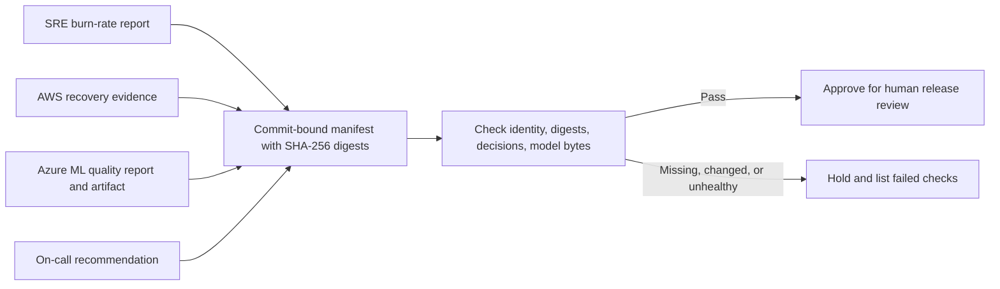

# Architecture

The gate expects healthy SRE, ready AWS recovery, ready model quality and observe from on-call, plus a SHA-256 match for every report and the model artifact. Missing, mismatched, or adverse evidence returns hold with a nonzero exit status. The integration runner produces the actual reports from all four projects in the same checkout group.

Use [the workflow template](github-actions/ci.yml) for a credential-free runner. An operator can retain a bundle with `python3 demo.py .. --evidence-dir build/healthy` and recheck it with `python3 gate.py build/healthy --commit 0000000000000000000000000000000000000001`. For a live pipeline, supply the real candidate SHA and create reports in a trusted CI job with protected artifact storage.
